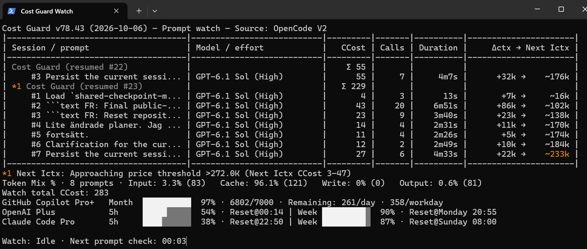
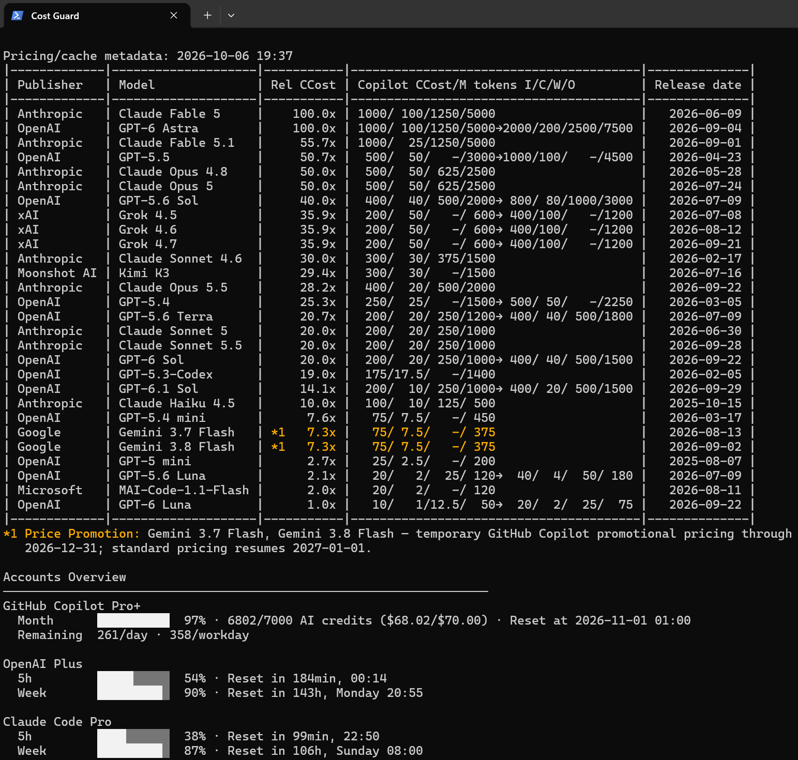
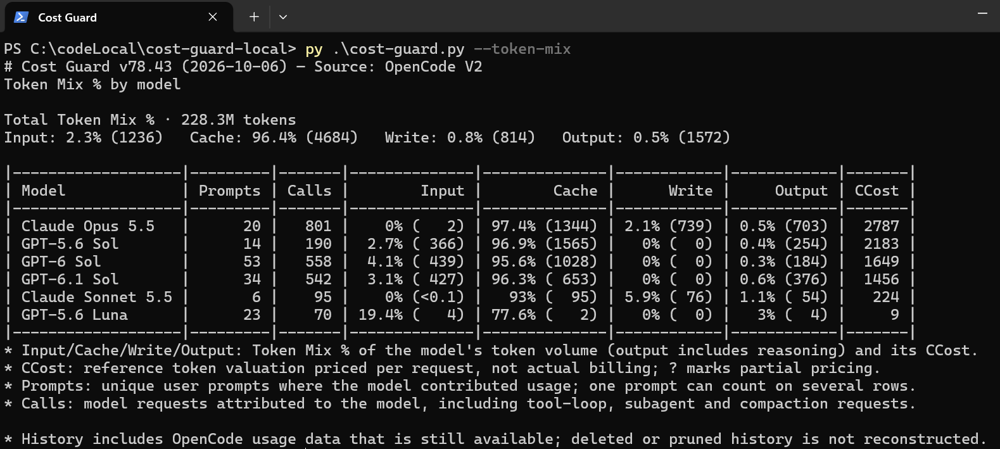

# Cost Guard

**Monitor AI model usage, cost and quotas in OpenCode.**

Cost Guard analyzes [OpenCode](https://opencode.ai/) prompts/sessions, relative model costs and account quotas locally, with real-time Watch.



Live OpenCode prompts: model/effort, CCost, calls, context and quotas.

## At a glance

- Monitor active OpenCode prompts and sessions in real time.
- Compare AI model costs; see CCost per prompt/session.
- Analyze Token Mix across input, cache read, cache write and output.
- Track context growth and causal usage, including subagents.
- Monitor account/subscription quotas across supported providers.
- Inspect available historical OpenCode sessions and prompts.
- Compare available AI models using your observed workload mix.

## Quick start

Cost Guard changes rapidly. Use **current `main`**: the latest supported Cost Guard code.

Without Git: [repository](https://github.com/qstoffe/cost-guard) → **main → Code → Download ZIP**. Extract with the folder structure intact; download again to update.

With Git:

```sh
git clone --branch main https://github.com/qstoffe/cost-guard.git
cd cost-guard
# Later, on main:
git pull --ff-only
```

Install **Python 3.11+**; standard supported OpenCode installations need no configuration.

### Optional Web Beta

Windows: `windows/Beta/Cost-Guard-Web.cmd`; experimental macOS: `macos/Beta/Cost-Guard-Web.command` (desktop acceptance pending). [Beta guide](docs/web-beta.md). Foreground: `python cost-guard-web.py --foreground`.

### Windows

Double-click the `.cmd` launchers under `windows/`:

Update old shortcuts/bookmarks to the hyphenated names; no aliases ship.

| Launcher | Mode |
| --- | --- |
| `Cost-Guard.cmd` | Normal model comparison/account quota report. |
| `Cost-Guard-Watch.cmd` | Live/global Watch; Ctrl+C stops Watch only. |

Report, Watch and Diagnostics open a **separate, persistent console** with PowerShell 7/5.1. Completion, errors and Ctrl+C leave a usable child prompt with Python's `$LASTEXITCODE` (9009 for missing Python 3.11+). The caller returns launch status only; for synchronous use run `py -3 cost-guard.py` (optionally `--watch`). See [download trust](#open-source-license-and-windows-download-trust).

### macOS

Equivalent launchers are under `macos/`:

| Launcher | Mode |
| --- | --- |
| `Cost-Guard.command` | Normal report. |
| `Cost-Guard-Watch.command` | Live/global Watch; Ctrl+C exits. |

Prefer `git clone` on macOS to preserve executable modes. If ZIP extraction loses them, run:

```sh
chmod +x macos/*.command macos/Beta/*.command development/user-tools/diagnostics/macos/*.command
```

Use Finder's **Open** for quarantine prompts.

Terminal examples: `windows\Cost-Guard.cmd`, `./macos/Cost-Guard.command`. Quote parent paths containing spaces, not these basenames.

See [CLI usage](#setup-and-usage); use `python3` on macOS or `py -3` on Windows if needed.

## Core concepts

### What Cost Guard counts

Distinct signals:

- **Usage:** observed model requests and input/cache/output/reasoning tokens.
- **CCost:** reference token valuation, not verified billing or credits deducted.
- **Billed:** actual monetary spend with reported or explicit subscription/zero-billing evidence; otherwise `N/A`.
- **Quotas / limits:** independent account-native windows, credits, budgets and availability.

Reference costs—including Watch **Today**—are **CCost**, unless labeled otherwise, not native **Used** or actual **Billed**. Included work can have CCost with Billed $0. Quota bars show **Used / Total**; **Remaining** pace describes capacity left. Quota credentials do not prove historical attribution.

### Symbols and token categories

Token Mix uses **I/C/W/O** for uncached input/cache read/cache write/output (including reasoning). See the [usage and cost reference](docs/usage-and-cost.md) for exact counting, rounding, symbols and attribution caveats. Session detail is opt-in, not a billing ledger.

## Reports and usage analysis

### Model comparison and account overview

Normal-report excerpt: model pricing/comparison using your observed workload mix, plus account quotas.



Details: [normal report](#normal-report), [model comparison](#model-comparison), [account quotas](#account-quota-blocks).

### Token Mix

`--token-mix`: historical model/publisher token volumes, I/C/W/O shares and CCost.



See [Token Mix reference](#token-mix--by-model---token-mix). Screenshots are illustrative and may show an earlier version.

## Requirements

- Python **3.11 or newer**.
- A supported OpenCode installation/history:
  - **V1:** The local legacy OpenCode SQLite database, read-only/query-only.
  - **V2:** Read-only registered-service loopback HTTP. **Start OpenCode Desktop V2 once after starting your computer** to start its background service; it may continue after Desktop closes. Reports retry brief readiness failures within a short budget; Watch waits/reconnects every five seconds, including during initialization. One installed-CLI wake remains supported; no automatic Desktop launch. See [connectivity and safe troubleshooting](docs/connectivity.md).
- Internet access for GitHub Copilot pricing/model metadata fetches.
- Optional Copilot quota reuses OpenCode OAuth in memory, without login, credential writes or GitHub CLI.
- Optional OpenAI subscription quota is fail-soft. Read-only V2 accounts take priority; legacy `auth.json` applies only without V2 rows. Credentials are never refreshed, rotated or written.
- Configured OpenAI/Anthropic API accounts are distinct from **Claude Code subscriptions**, discovered through the optional installed `claude` CLI. Cost Guard never reads/copies Claude credentials or attributes current login to history.
- Claude Code quotas use optional experimental SDK-control metadata (no prompts, transcript scans or new dependencies); accounts stay visible when quotas fail. Successful retrieval does not guarantee current upstream values. Diagnostics separates retrieval, value changes and Watch publication with bounded observations. See [Claude integration and limitations](development/architecture/modules/claude-code.md).
- OpenRouter/DeepSeek accounts reuse configured OpenCode API keys through maintained read-only HTTPS endpoints. MiniMax Token Plan uses its dedicated subscription integration; generic API keys do not establish subscription entitlement.
- No third-party Python packages are required.

## Setup and usage

Check `python --version` is 3.11+. Full commands, from the repository root:

```text
python cost-guard.py                            # Available models + account quotas
python cost-guard.py --all-models               # Full pricing/model catalog only
python cost-guard.py --token-mix                # Total and per-model Token Mix %/CCost, all available history
python cost-guard.py --sessions 10              # Latest 10 available root sessions
python cost-guard.py --sessions all             # All available root sessions
python cost-guard.py --watch                    # Global Watch; Ctrl+C exits
python cost-guard.py <session-id>               # One session
python cost-guard.py <session-id> --watch       # Watch one session/root tree
python cost-guard.py 2026-08-24                 # One local calendar day
python cost-guard.py 2026-08-01:2026-08-31      # Inclusive local date range
python cost-guard.py --version
python cost-guard.py --help
```

See [Quick start](#quick-start) for launchers.

Cost Guard uses `config/default-config.jsonc`. Create optional `config/user-config.jsonc` beside it only for overrides.

## Open-source license and Windows download trust

Cost Guard uses **0BSD**: use, modify and redistribute, including commercially, without attribution. See `LICENSE`.

Windows source ZIPs use the same `.cmd` launchers; retain the folder structure. SmartScreen may warn about unsigned downloaded launchers. Verify the ZIP came from this repository's `main` before removing download marks from the extracted repository root:

```powershell
Get-ChildItem -Recurse | Unblock-File
```

No signing certificate ships.

## OpenCode V1/V2 source selection

The shipped default is:

```jsonc
{
  "openCode": {
    "source": "auto"
  }
}
```

`auto` selects **one** healthy source: V2 first, otherwise V1; histories are never merged. Force `v1`/`v2` only for troubleshooting or a legacy workflow.

With V2 selected, a metadata-only V1 check finds missing/newer legacy sessions. Reports note them only if they can affect the shown scope (latest-prompt sample, dates, session, all history); Watch never; Diagnostics always counts them. Nothing is repaired/written.

Reports show `OpenCode not found` only when selection fails and no PATH executable or standard installation evidence exists. Usable sources work without the CLI; Watch still waits/retries.

## Normal report

`python cost-guard.py` shows definitions, models/notices and `Accounts Overview`. Token Mix uses the latest 100 visible priced prompts, including running/child work. Account CCost independently loads relevant local-day/window/month history, without changing that sample or adding prompt detail/graphs.

### Model comparison

**Relative CCost** uses one pooled I/C/W/O mix for every model/tier, tried or untried: latest **up to 100 completed priceable prompts globally**, actual count shown. Common workload prices are not same-task capability/throughput benchmarks, billing or specialized-job forecasts. Dashboard/historical Token Mix stays separate. [Details](docs/usage-and-cost.md#model-comparison).

Availability uses settled V2 `/api/model` IDs (V1: `opencode models`), exact/verified aliases and explicit variant rates. Ambiguous prices stay unknown; failed lookups warn/show the catalog. Unpriced models have no row.

Both modes sort by full-Decimal base/higher price descending, earlier context boundary, then name alphabetically; repeat for later tiers. One-decimal display never controls order; unknown prices stay unknown.

**Faded rows** mean a newer recognized same-family/variant version is shown here, not official deprecation. Matching is conservative/numeric; selection, ordering and prices stay unchanged. See [model comparison](docs/usage-and-cost.md#model-comparison).

`--all-models` adds exact native **GitHub USD/M I/C/W/O**: all tiers/boundaries even without a mix, no availability/accounts. Normal reports have four columns:

| Column | Meaning |
| --- | --- |
| `Publisher` | Model creator/group. |
| `Model` | Model display name. |
| `Relative CCost` | Shared-reference tier multipliers: markers left, multipliers right, reserved arrows/threshold fields. |
| `Release date` | Public model release date when confidently available. Recently released models are highlighted/notified. |

✦ New Models lasts seven UTC days after release (Watch: or after a verified catalog addition when no date exists; never invented); report promotion markers last through validity. Watch promotion notices need a proven start within seven days. Only notice labels are colored.

## Token Mix % by model: `--token-mix`

Scans available history (cold runs can be slow). `Total Token Mix % · <volume> tokens` precedes selectable models' `Prompts`, `Calls`, `Tokens`, I/C/W/O shares/category CCost and total `CCost`. Narrow terminals use labeled rows.

Publisher rows pool the same requests at original model/tier CCost. Unknown manufacturers stay unverified; prompts are not additive.

- `Prompts`: distinct contributing user prompts per model. Mixed-model prompts count on multiple rows; counts are not additive.
- `Calls`: attributed model requests, including tool-loop, subagent and compaction work. Both counts indicate sample size.
- `Tokens`: known I/C/W/O (Output includes reasoning); K/M/B display, exact Web sorting. `?` partial; `N/A` unknown.
- Deleted or pruned history is not reconstructed; no private ledger exists. Rows never imply which account or subscription served a model.
- If current model availability cannot be established, all historically used models are shown with a warning (fail open).

Launchers immediately show `Cost Guard: Checking requirements...`, without Python. This row stays until Python progress can replace it. Interactive progress uses approximate (`~`) mode-specific time/work estimates; unknown stages show a spinner without a percentage. Only successful startup reaches 100%; redirected output uses plain stage lines.

## Available sessions: `--sessions N|all`

Shows only a session table and legend, newest causal-tree activity first (not cost). `N` is a positive maximum; an oversized limit or `all` shows all available root sessions, including available archived sessions. Descendants belong to their root rather than appearing as duplicate detail targets. No aggregate Total row is shown.

| Column | Meaning |
| --- | --- |
| `Session id` | OpenCode root-session ID. |
| `Name` | Session title. |
| `Model` | Primary model by attributed CCost; trailing `*` means another model also contributed. |
| `CCost` | Reference valuation for the entire available session, across day/month boundaries; not billing. |
| `#` | Relevant visible prompts across the entire session; compactions remain distinct detail events, not user prompts. |
| `Duration` | Accumulated execution wall-clock time of the root's prompts and compactions, including attributed child work; overlapping intervals count once. |

## Session and date detail reports

Passing a session ID prints one snapshot and exits, even with active work; use `--watch` for tracking. `[RUNNING]` metrics are provisional observed usage; unsupported values stay unknown. Date/date-range modes use the same table against their selected scope. Neither fetches model availability or account quotas.

| Column | Meaning |
| --- | --- |
| `Prompt` | Local time, prompt number and preview. Separate `Model:` and `[ABORTED]` timeline rows provide history context. `/compact` is shown as its own event. |
| `CCost` | Reference token valuation of the prompt/event, independent of billing; `?` marks a partial subtotal. |
| `Calls` | Completed causal model requests belonging to the prompt/event. |
| `Duration` | Prompt/compaction execution wall-clock time, using the same compact format and rounding as Watch. |
| `~Ictx` | Incoming context or `Δctx -> Next Ictx` when the chronological context state is available. |
| `~Ictx CCost` | Incoming-context reference valuation, not billing. |
| `~Extra CCost` | Additional causal usage reference valuation beyond incoming context, not billing. |
| `I/C/W/O %` | Observed token mix, including supported running session usage; otherwise unknown/running. |

Known causal splits show **Main / Subagents / Total**; running prompts may show `running - consider ABORT`. `(Next Ictx CCost 0.3–3)` is the next input's cached–fresh CCost range; price-threshold warnings show `(1.9x more expensive)`, the model table's Relative CCost ratio across that threshold. Amber `nextIctxWarning`: approaching highlights the marker; exceeded the full explanation.

Duration excludes idle gaps, session creation time and unrelated child work: 20 minutes of work followed three days later by 40 minutes totals `1h`, not three days. It includes reasoning, tools, attributed subagents, verified background waits, compactions and failed/cancelled execution with reliable timing. Detail Total unions only the selected prompt/event intervals (also for date ranges); it never sums overlapping parent/child time twice. Running intervals use the report observation time; completed intervals stay fixed. Historical/archived sessions need no prior Watch run, but unavailable/deleted history cannot be reconstructed. A missing or invalid execution boundary is `N/A`, and any included unresolved interval makes the total `N/A`, not a misleading subtotal. No separate tracking ledger or history migration is needed.

Moving a session keeps its ID and accounting. Completed rows retain historical context; current continuation and warnings become N/A until a qualifying post-boundary request. [Context semantics](docs/usage-and-cost.md#continuing-context-and-history-changes) explain comparisons and uncertainty.

A one-shot session report automatically follows an already-running latest prompt until that prompt completes or aborts.

Persisted V2 terminal evidence ends the matching attempt (duration freezes) and keeps failure/cancellation/success distinct; inactivity or disconnection alone proves no end, and usage/cost is unchanged.

## Account quota blocks

Only detected/configured accounts appear, retaining source-aware identities. Upstream labels or neutral ordinals distinguish same-provider rows; Personal/Work labels are never invented.

Shared read-only discovery skips absent providers. Four quota workers overlap analysis; final waiting is capped at 15s, never inventing capacity. See [acquisition contracts](docs/account-support.md#credentials-refresh-and-troubleshooting).

Accounts share aligned 10-cell remaining bars, native values, resets and narrow fallback. Bars require real provider-reported capacity (a denominator or explicit percentage); balance/spend alone stays textual and is never CCost.

Reports explain daily/window/local-month CCost and provider/account provenance. CCost is neither billing nor quota consumption; ambiguous accounts stay unknown. See [period accounting](docs/usage-and-cost.md#account-period-ccost).

**OpenRouter** shows authenticated-key Day/Week/Month spend and genuine key limits; **DeepSeek** shows separate native balances without a fabricated bar; **MiniMax Token Plan** supports native subscription windows, not entitlement inferred from a generic key. See [account support](docs/account-support.md) for all providers, Copilot Remaining/overage semantics, alignment, resets and limitations.

## Watch

Global Watch keeps history above active/recent sessions in one six-column table, with one horizontal divider only when both groups exist. A whole session stays in the lower group while any prompt runs or retains its finite completion/abort/error highlight (`watchRecentEventSeconds`). There, ordering and header time use latest prompt/`/compact` start; history uses latest supported completion/terminal time (event start if unavailable). Both groups sort oldest first with session-ID ties. Highlight expiry moves the block to history even while idle, showing the event end, never poll/expiry time; a new prompt/compaction moves it back. Session-specific Watch keeps its existing ordering and start-time header.

Headers span two columns with aligned two-character prefixes and configured-local `HH:mm`. Running sessions/prompts use `▶`; successful completions show a temporary green `✓`, aborts and terminal failures a temporary red `!` and critical row styling. After `watchRecentEventSeconds`, emphasis and final tool/Skills rows disappear; neutral `[ABORTED]`/`[ERROR]` labels remain. Historical startup failures get no fresh highlight; polling, redraws, quota refreshes and resync do not renew it. Zero disables transient effects, not outcome labels or running status. `watchDashboardMaxRows` (default 12) remains one soft prompt-row cap: newest unprotected rows, Earlier or ordinary, win; running rows and finite recent highlights stay protected above it. Selection precedes block grouping, whose times use all available session events, not just cap-selected rows. A block disappears only when its last selected row is evicted; there is no idle timer. See [Watch lifecycle and activity](docs/watch-activity.md).

`watchStartupEarlierSessions` (default 2; 0 disables) selects at most that many representatives once at startup, by latest pre-Watch prompt start. Their single rows compete unprotected for the global cap and never replenish after eviction; a prompt or `/compact` transitions the session to ordinary activity. The timestamp precedes gold-orange `[Earlier]`: `HH:mm` on the configured local date, otherwise `YYYY-MM-DD HH:mm`. Earlier usage stays out of Token Mix and `Watch total CCost`; one shared `[Earlier] Session activity before Watch started; excluded from Token Mix and Watch total CCost.` explanation appears while any representative is visible. Identical context warnings retain shared numbered footnotes.

Watch's first view never waits for quotas. An account-only scheduler refreshes healthy providers every 30 seconds from refresh start, independently of source activity. With whole-provider acquisition ≤20s, scheduler overhead ≤1s and publication/rendering ≤2s, newly available native values reach Watch within 60s (budget ≤53s), idle or active. Upstream propagation, outages and a blocked local render/hydration operation cannot be guaranteed away. See [freshness and diagnostics](docs/account-support.md#watch-freshness-budget).

| Column | Meaning |
| --- | --- |
| `Session / prompt` | Grouped prompt/event rows; `▶` marks each running prompt and the session while any prompt runs. The latest prompt retains final tool/failure counts and loaded Skills until its terminal highlight expires or a new prompt supersedes it. Activity arrows align with `#`; tool failures stay red and do not imply prompt failure. |
| `Model / effort` | Explicit/request-proven effort, otherwise `(Default)` for a known normal request. Active context warning `*N` follows the affected value and points to its footnote; model and effort truncate independently in the fixed-width column. Compaction shows only its own explicit effort. |
| `CCost` | Current observed prompt/event reference valuation, not billing. |
| `Calls` | Completed causal model requests. |
| `Duration` | Wall-clock duration; a prompt stays running (footer `background shell`) while its verified background job runs. |
| `Δctx -> Next Ictx` | Historical effective context for completed rows; continuing context for live work. N/A when unsupported. |

[Watch activity](docs/watch-activity.md): yellow `Skills (N)` lists confirmed exact IDs, newest first; red `[N tool call failures]` requires direct evidence, never load recency. Native errors and recognized Toolkit error contracts count once; cancellations and exit codes alone do not. Narrow rows preserve total/failures and whole skill IDs with `+N more`; the metric table keeps fixed geometry.

Session `Σ` sums its displayed prompt/event CCost before rounding, preserving `?`/`N/A`. Native non-billable compactions contribute zero with blank row cost. Rounded row strings need not sum to the subtotal.

`Token Mix % · N prompts` shows run-scoped unique prompts, shares and CCost of priced requests only. Startup-running requests, between-poll completions, child work and compactions qualify; completed pre-Watch history does not. `CCost · Watch: <run> · Total today: <day>` retains run usage across eviction, disappearance, resync and moves (zero when empty; `?` when partly priced). Today combines available local-day history with deduplicated requests observed and retained by this Watch. Requests deleted before observation cannot be reconstructed; restart uses available history, not a ledger. From local midnight until 03:00, `Total today` reads `Total YYYY-MM-DD`, even while idle. Row `Σ` can differ: startup mid-prompt may show row/Σ `78` but run `59`.

First daily accounting may show Pending; refreshes/failures retain the complete same-day value until atomic replacement, allowing corrections. Midnight starts a new scope. Bounded enrichment is quota-independent; Today needs no month scan. All running candidates remain discoverable; scoped Watch keeps global Today.

Any account count uses compact rows when they fit, then split rows, otherwise individual wrapped blocks. Resets use `Reset@...`; fixed quotas with Remaining omit duplicate compact reset text, retained in reports/narrow fallback:

```text
GitHub Copilot Pro+   Month  ██████████ 100% · 7000/7000 · Today: 1467 · Remaining: 259/day · 350/workday
OpenAI Plus          5h     ████████░░  82% (651) · Reset@22:49 | Week ██████████  98% (25407) · Reset@Sunday 07:59
```

Per-account `Today` is daily CCost; percentage parentheses are window CCost, not utilization. Unknowns use `—`, without fake bars. Watch has no month-to-date or Unaccounted usage row. [Accounting details](docs/usage-and-cost.md#account-period-ccost).

`Watch:` stays last. Startup progress stops before dashboard/recovery output. Watch buffers frames, skips identical output and patches changed rows when they fit. Wrapped or taller-than-viewport dashboards clear and rebuild the screen/scrollback, keeping only the current frame scrollable instead of accumulating old title/table fragments; returning from overflow also clears stale fragments. Safe resizes overwrite without clearing; shrinking frames erase their old tail. Countdowns update only the status row. Pending appears only before the first complete publication for a local day. Redirected output stays plain.

`[ABORTED by …]` names proven user/quota/tool-call/step/rate-limit causes; unknown stays `[ABORTED]`. V2 live `reason: user` is matched to the same persisted interruption and retained only in bounded process memory, not reconstructed from older history or after restart. `[ENDED after tool calls]` never guesses a limit. Labels outlast red emphasis. Quotas become stale after a failed refresh or an observation age over 60s, and expire after five minutes, including resume. Transient failures get bounded 5/10/20s retries; auth/capability failures get no fast retry.

V1 Watch uses process-free SQLite gating; V2 events are hints with a five-second cooldown and authoritative resync. `"auto"` refresh adapts within 5–30 seconds; quota refresh is independently rate-limited.

**Watch troubleshooting.** Before connection, Watch suggests starting Desktop V2 if needed. Failures during first catalog/snapshot reads recover without partial rows or repeated quota requests. Later outages keep the last dashboard, retry the same source every five seconds and resync snapshots/events; no V1 fallback or recurring CLI start. Unsupported schemas or data unreadable for ~1 minute remain terminal. Ctrl+C stops Watch, not OpenCode. See [connectivity guidance](docs/connectivity.md).

## Pricing, quota and network behavior

Watch checks Copilot hourly; 15-minute V2 checks trigger early refresh only for newly observed IDs. ✦ New Models requires verified priced models; CCost stays pinned. Independent release-date recovery uses models.dev/changelog, ~1/5/15-minute then hourly retries, respecting 429 and retaining verified dates. Expired promotions revert to verified rates or are withheld.

Quota credentials stay memory-only: V2 precedes legacy, explicit `authJsonPath` is file-only, inactive accounts never change login. No replacement credentials or other-installation search; OpenAI/Claude remain version-sensitive/fail-soft.

## Configuration

`config/default-config.jsonc` owns defaults, thresholds and colors. Optional `config/user-config.jsonc` recursively overrides defaults and never ships.

Useful settings include:

- `ccostDisplayUnit`: `credits` (default) or `usd`; CLI override: `--ccost-unit usd`. Web's CCost selector is page-memory only; reload restores configuration. 100 credits = $1.00 reference USD, not billing; small positive amounts may show $0.00. Quotas/Billed/rates are unchanged.
- `runningPromptWarningCCost`: 1800 credits by default (0 disables), independent of display units.

- `openCode.source`: `auto`, `v1` or `v2`.
- `timezone`: local day/timestamp zone. The shipped `Europe/Stockholm` default works without an external tzdata package; other custom IANA zones require host/Python zoneinfo data.
- `workdayCalendar`: `SE` for Swedish weekends/public holidays, or empty for weekends only.
- `copilotQuota.enabled` / `authJsonPath`: optional account lookup controls.
- `openAiQuota.enabled` / `authJsonPath`: fail-soft OpenAI ChatGPT/Codex usage lookup controls.
- `anthropicQuota.enabled`: Anthropic API and Claude CLI account lookup; `authJsonPath` overrides only the API-account inventory.
- `openrouterQuota`, `deepseekQuota`, `minimaxQuota`: `enabled` / `authJsonPath` only; maintained endpoints and mappings cannot be customized.
- `sessionWatchIntervalSeconds`: `"auto"` (default, adaptive 5–30 seconds) or an explicit compatible integer.
- `pricingMaxAgeHours`: pricing/model metadata cache age.
- `thresholds`: running-cost, context, percentile and quota warning thresholds.
- `colorScheme`, `colorSchemes`, `colors`: terminal palette selection and per-role overrides.

`modelComparisonNew` colors new names/dates; `modelComparisonPromotion` colors active rates/Relative CCost. Superseded colors fade; plain output is unchanged.

Invalid configuration fails at startup; legacy `monthlyAiCredits` is ignored.

## Cache and concurrent Cost Guard processes

Runtime acceleration state is created under:

```text
cache/
  cost-guard-cache-v2.sqlite3
```

The cache is disposable. Stop Cost Guard before deleting `cache/`; the next run rebuilds it. Breaking schemas use a new generation filename, never migration/deletion of an in-use database.

SQLite WAL, short transactions and bounded waits support concurrent report/global/session Watch.

## Diagnostics for environment-specific problems

For troubleshooting, use `development/user-tools/diagnostics/windows/Cost-Guard-Diagnostics.cmd` (macOS: `macos/Cost-Guard-Diagnostics.command` in the same diagnostics folder), or run:

```text
python development/tools/collect_diagnostics.py
```

Creates `diagnostics/cost-guard-diagnostics.zip`: Full/local tests, validation, environment/source facts, report/headless Watch timings and provider errors. `--no-network` skips pricing/quotas; `--skip-validation` is emergency/recursive-only.

Bundles omit prompts/titles, raw payloads/auth, tokens and account labels/IDs; source IDs are hashed. Inventory needs no live accounts.

### Internal software faults

**`COST GUARD FAILED`** means an unexpected software fault: non-zero exit, an error log under `logs/errors/` and a report under `logs/crashes/`. Stopping errors end with the Diagnostics launcher path; nothing starts automatically. Isolated faults show ERROR while safe results continue. [Error diagnostics](docs/runtime-errors.md) explains privacy, 30-day retention and reporting fallback.

## Current version

**v80.112 (2026-10-29):** Web CCost Credits/USD selector; page-memory only, no acquisition or repricing.

Earlier changes: [version history](VERSION_HISTORY.md). [Live-proof limits](development/architecture/modules/history-loading.md#startup-presentation-and-launcher-evidence). Claude quotas remain experimental.

Versions identify code, not tags, ZIPs or GitHub Releases. Packaged Releases remain paused; resuming them requires an explicit policy decision, never a version-number trigger.

## Development

Development workflow and Feature Request guidelines: [development/README.md](development/README.md).

Installed OpenCode Toolkit skills own `/repo-backlog` workflow. Verify the working tree, not ZIPs; development-only changes require no product tests, validator or versioning.

[Code/test map and inventory review](development/architecture/modules/CODE_MAP.md); refresh with `python development/tools/code_inventory.py --json`.

```text
python development/tools/run_tests.py --suite quick
python development/tools/validate_package.py --working-tree
python development/tools/run_tests.py --suite full
python development/tools/collect_diagnostics.py
```

Hosted/web AI runs Quick + validation; local sessions run Full + validation + live checks. No local product-release ZIP is routinely generated; current `main` remains the supported source distribution. Diagnostics bundles are separate troubleshooting artifacts.
`--working-tree` excludes root `.vs/` generated IDE state without reading or deleting it. It does not ignore nested `.vs/` directories or arbitrary project files. Without that flag, an explicit distributable containing root `.vs/` fails validation; normal path, size, encoding, security and Python checks remain active.
