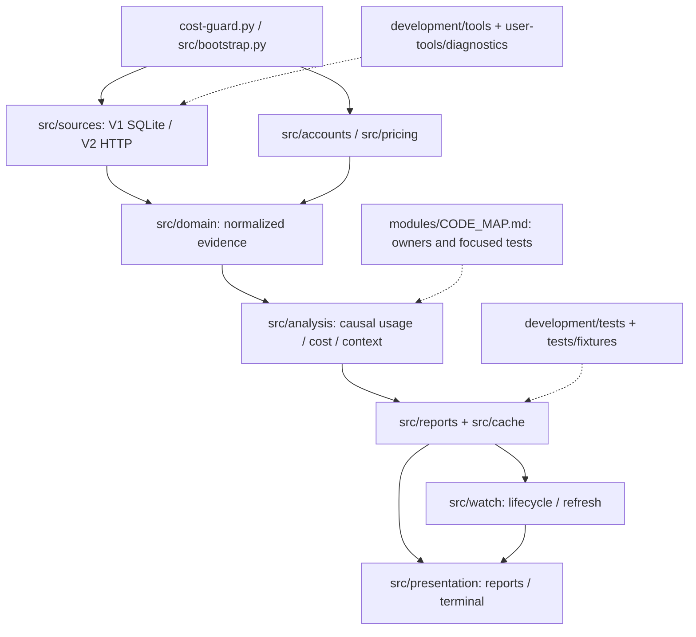

# Cost Guard v80 architecture

Source revision: a97a6c8a13a845bda25624acd9fefbea27761373
Checked revision: a97a6c8a13a845bda25624acd9fefbea27761373
Last checked: 2026-10-25
Status: current

## Development data and authority

Development contains product tests/fixtures, architecture/navigation, diagnostic tooling, engineering knowledge and backlog specifications; it defines no local process authority or verification gate. The actively loaded compatible OpenCode Toolkit shared repository skills govern layout, FR authoring, backlog work and maintenance. Historical files/FRs are evidence, not competing instructions. This overview replaces the legacy development-root README/router; the installed manifest reserves that root for adapter and applied-revision facts.

Repository facts (`../repository.json`) retain opaque compatibility data; Cost Guard alone owns product versions and release checks. Applied-contract.json (`../applied-contract.json`) records revision, never proof without actual topology. Pending (`../backlog/todo/`), completed (`../backlog/complete/`), reserved human-review suggestions (`../backlog/suggestions/`) and rejected suggestions (`../backlog/rejected-suggestions/`) retain one backlog. Journal INDEX routes retained knowledge.

Repository-relative owners: deterministic `development/tests/`, synthetic `development/tests/fixtures/`, reserved `development/tests/integration/live/`, scripts `development/tools/`, and human `development/user-tools/diagnostics/windows/` / `macos/` launchers. Development-only work has no local package gate, regression-suite mandate, structure/file budget or product version bump. Shipped product changes retain relevant tests, runtime/package/security safeguards and release facts; source changes must never be misclassified as development-only.

## Navigation



Owner/test routes (`modules/CODE_MAP.md`) and the module contracts below route history acquisition, provider integrations, launchers and failure/privacy facts; journal knowledge (`development/journal/INDEX.md`) routes historical performance evidence. These are source contracts/navigation, not measured current test coverage. Installed Toolkit owns development procedure. Account-period CCost stays inside existing analysis/report/Watch boundaries; the Reports and Watch contracts name the period index and regressions.

## Goals

Retain v78 Python/v77 behavior contracts; integrations add, not rewrite.

Core product principles:

- standard supported OpenCode installations should work without Cost Guard configuration;
- OpenCode persistence is authoritative and read-only;
- Cost Guard cache is disposable acceleration state, never durable user history;
- one analysis core serves reports and Watch;
- provider/source-specific formats stop at their adapter boundary;
- concurrent global Watch, session Watch and one-shot reports must be safe;
- recurring external process starts are avoided, especially in Watch.

## Runtime layers

```text
cost-guard.py
    -> src.runtime_errors (minimal process guard, before application import)
       -> src.bootstrap (composition root)
       -> CLI/config/source/provider selection
       -> Session Source(s) -> normalized domain
       -> Account Provider(s) -> normalized quota/account domain
       -> Pricing Provider(s) -> normalized pricing domain
       -> analysis core
       -> cache repositories
       -> report projections / Watch coordinator
       -> presentation
```

## Configuration

`src/config.py` owns JSONC, v77-compatible recursive merging, legacy normalization and startup validation. Omitted properties inherit defaults; explicit null overrides. Optional `config/user-config.jsonc` is never auto-created.

Configuration must be validated before any OpenCode/provider/network/runtime-cache work. Errors use terminal-default presentation and must not echo arbitrary configured paths/secrets. `openCode.source` is normalized to `auto|v1|v2`; concrete source selection remains outside the config layer.

## Module contracts

| Owner | Contracts |
| --- | --- |
| Session Sources | [sources.md](modules/sources.md) |
| Account and Pricing Providers | [providers.md](modules/providers.md) |
| Canonical domain / Analysis / Cache | [analysis.md](modules/analysis.md) |
| Reports | [reports.md](modules/reports.md) |
| Watch | [watch.md](modules/watch.md) |
| Presentation and CLI / Software-failure boundaries / Diagnostics boundary | [presentation-diagnostics.md](modules/presentation-diagnostics.md) |

The code map names focused tests; static paths do not establish current test coverage. Historical performance evidence retains its original validity limits.

## Dependency direction

```text
bootstrap
  -> config / sources / accounts / pricing / analysis / reports / cache / watch / presentation
sources/accounts/pricing/cache
  -> domain (and narrowly defined lower-level shared contracts), never reports/presentation
analysis
  -> domain + provider-neutral pricing contracts, never reports/presentation
reports
  -> domain + abstract source/account/pricing + analysis/cache, never concrete integrations/presentation/watch
presentation
  -> report projection/domain display types, never concrete integrations
domain
  -> Python standard library only
```

The product validator resolves absolute/relative/nested layer imports, rejects runtime→development edges and V2 process/SQLite use. `code_inventory.py` owns AST navigation/metrics, not measured coverage. `modules/CODE_MAP.md` routes responsibilities and focused tests. Installed Toolkit governs development-only changes; product release/security checks remain independent.

