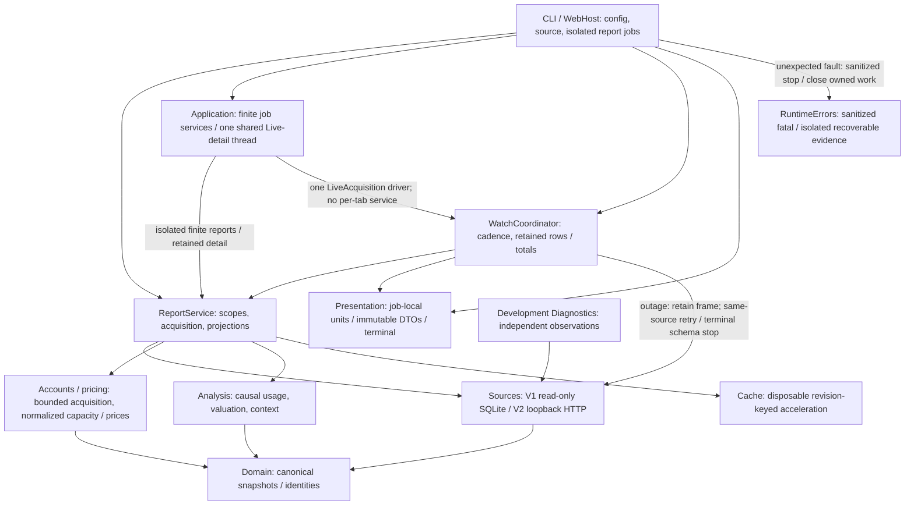
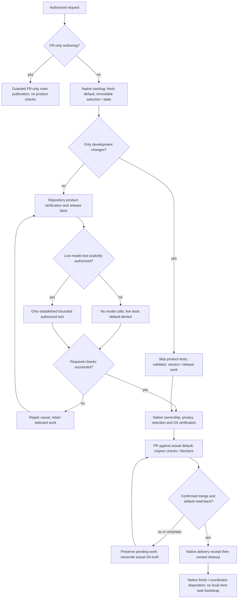

# Cost Guard v80 architecture

Source revision: a27d5fede5d07a7a2e992691b34790b6017cd780
Checked revision: a27d5fede5d07a7a2e992691b34790b6017cd780
Last checked: 2026-10-28
Status: current

## Development data and authority

Development contains product tests/fixtures, architecture/navigation, diagnostic tooling, engineering knowledge and backlog specifications; it defines no local process authority or verification gate. The actively loaded compatible OpenCode Toolkit shared repository skills govern layout, FR authoring, backlog work and maintenance. Historical files/FRs are evidence, not competing instructions. This overview replaces the legacy development-root README/router; the installed manifest reserves that root for adapter and applied-revision facts.

Repository facts (`../repository.json`) retain opaque compatibility data; Cost Guard alone owns product versions and release checks. Applied-contract.json (`../applied-contract.json`) records revision, never proof without actual topology. Pending (`../backlog/todo/`), completed (`../backlog/complete/`), reserved human-review suggestions (`../backlog/suggestions/`) and rejected suggestions (`../backlog/rejected-suggestions/`) retain one backlog. Journal INDEX routes retained knowledge.

Repository-relative owners: deterministic `development/tests/`, synthetic `development/tests/fixtures/`, reserved `development/tests/integration/live/`, scripts `development/tools/`, and human `development/user-tools/diagnostics/windows/` / `macos/` launchers. Development-only work has no local package gate, regression-suite mandate, structure/file budget or product version bump. Shipped product changes retain relevant tests, runtime/package/security safeguards and release facts; source changes must never be misclassified as development-only.

## Navigation



Arrows show calls/consumption, not a single linear execution pipeline. `src/web/host.py` owns HTTP/jobs and one `src/application/live.py` thread. `src/web/jobs.py` isolates finite report processes with parent-loss cleanup. The live thread ticks Watch and `src/application/session_detail.py`; `src/reports/session_history.py` retains observed evidence outside cache. HTTP leases/pages never acquire source data. Source-change stops, never reloads; CLI/Diagnostics remain independent. `src/web/` owns loopback HTTP/security/assets, bounded SSE/replay, finite report processes, private instance/restart locks and best-effort source-change stop. Windows and experimental macOS menus share this host; macOS native proof is pending. Web reuses Watch's renderer-independent acquisition seam, not a CLI process or per-tab coordinator. Bootstrap dispatches CLI reports/Watch directly. Source normalization establishes evidence, not cost; analysis consumes provider-neutral pricing contracts. The cache never replaces source authority. Recovery belongs to acquisition, not rendering. `src/numbers.py` scopes CCost display units with exception-safe ContextVar reset; canonical valuation and native quotas are unchanged.

`modules/CODE_MAP.md` and the module contracts route owners/tests, history, providers, launchers and failure/privacy facts; `development/journal/INDEX.md` routes historical evidence, not current coverage. Toolkit owns development procedure. Account-period CCost and its indexed regressions remain inside analysis/report/Watch.

## Goals

Retain v78 Python/v77 behavior contracts; integrations add, not rewrite.

Core product principles:

- standard supported OpenCode installations should work without Cost Guard configuration;
- OpenCode persistence is authoritative and read-only;
- Cost Guard cache is disposable acceleration state, never durable user history;
- one analysis core serves reports and Watch;
- provider/source-specific formats stop at their adapter boundary;
- concurrent global Watch, session Watch and one-shot reports must be safe;
- recurring external process starts are avoided, especially in Watch.

## Runtime layers

```text
cost-guard.py
    -> src.runtime_errors (minimal process guard, before application import)
       -> src.bootstrap (composition root)
       -> CLI/config/source/provider selection
       -> Session Source(s) -> normalized domain
       -> Account Provider(s) -> normalized quota/account domain
       -> Pricing Provider(s) -> normalized pricing domain
       -> analysis core
       -> cache repositories
       -> report projections / Watch coordinator
       -> presentation
```

## Configuration

`src/config.py` owns JSONC, v77-compatible recursive merging, legacy normalization and startup validation. Omitted properties inherit defaults; explicit null overrides. Optional `config/user-config.jsonc` is never auto-created.

Configuration must be validated before any OpenCode/provider/network/runtime-cache work. Errors use terminal-default presentation and must not echo arbitrary configured paths/secrets. `openCode.source` is normalized to `auto|v1|v2`; concrete source selection remains outside the config layer.

## Module contracts

| Owner | Contracts |
| --- | --- |
| Session Sources | [sources.md](modules/sources.md) |
| Account and Pricing Providers | [providers.md](modules/providers.md) |
| Canonical domain / Analysis / Cache | [analysis.md](modules/analysis.md) |
| Reports / optional application boundary | [reports.md](modules/reports.md) |
| Optional Web / lifecycle | [web.md](modules/web.md) |
| Watch | [watch.md](modules/watch.md) |
| Presentation and CLI / Software-failure boundaries / Diagnostics boundary | [presentation-diagnostics.md](modules/presentation-diagnostics.md) |
| Windows console | [windows-launchers.md](modules/windows-launchers.md) |

Test routes are not executed coverage; historical performance evidence keeps its original limits.

## Dependency direction

```text
bootstrap
  -> config / sources / accounts / pricing / analysis / reports / cache / watch / presentation
sources/accounts/pricing/cache
  -> domain (and narrowly defined lower-level shared contracts), never reports/presentation
analysis
  -> domain + provider-neutral pricing contracts, never reports/presentation
reports
  -> domain + abstract source/account/pricing + analysis/cache, never concrete integrations/presentation/watch
web
  -> application and composition-only concrete integration wiring; never browser-side acquisition/valuation
application
  -> reports/domain/analysis, never bootstrap/presentation/watch or web
presentation
  -> report projection/domain display types, never concrete integrations
domain
  -> Python standard library only
```

The product validator resolves absolute/relative/nested layer imports, rejects runtime→development edges and V2 process/SQLite use. `code_inventory.py` owns AST navigation/metrics, not measured coverage. `modules/CODE_MAP.md` routes responsibilities and focused tests. Installed Toolkit governs development-only changes; product release/security checks remain independent.

## Validation, review and delivery flow

Observed 2026-10-28: this is a descriptive route, not a new gate or local scheduling policy. Installed Toolkit owns selection/transactions and remote lifecycle; repository scripts own product checks. No repository live-model runner or automatic PR self-review is introduced.



### What runs and why

| Stage | Scope / activation | Disposition | Exact source owner | Failure handling |
| --- | --- | --- | --- | --- |
| FR publication | Approved FR-only authoring | Required safety; product checks skipped | Installed `shared-repo/references/fr-authoring.md` | Preserve pinned/foreign work; reconcile fresh default |
| Selection / nextState | Backlog and scheduled maintenance | Required native safety | Installed `/repo-backlog`, `development/backlog/maintenance-state.json`, `identity-state.json` | Selection immutable; no invented counters |
| Development-only | All changed paths under development | Product checks/version disabled | Installed `shared-repo/references/contract.md`; this tree's `development/README.md` | Do not activate product gates for documentation/state |
| Product verification | Shipped-source changes | Repository-owned applicable tests/security checks | `development/tools/run_tests.py`, `development/tools/validate_package.py`, `src/version.py`, `VERSION_HISTORY.md`, `README.md` | Investigate/repair required failures; never weaken assertions |
| Real installation / live tests | Relevant product proof; model inference separately authorized | Read-only probes conditional; live-model default-denied | `development/tools/collect_diagnostics.py`; `development/tests/integration/live/` is reserved, not an implemented runner | Do not stop shared OpenCode; disclose unavailable proof; no invented freeze/dispatch owner |
| PR / merge | Authorized delivery | Required Git safety; self-review not a gate | Installed `/repo-backlog` and actual GitHub default/protection/check state | No force/protection bypass; uncertain merge requires read-back, not replay |
| Delivery / cleanup | Confirmed merge on fresh default | Required native receipt/owned cleanup | Installed native `repo_backlog` operations | Preserve recovery evidence; cleanup failure permits finish with retained leftovers |

Milestone-40 source assessment: `development/journal/architecture.md` (runtime no-change; sampling/display owners and unmeasured risks). Native desktop proof remains separate.
