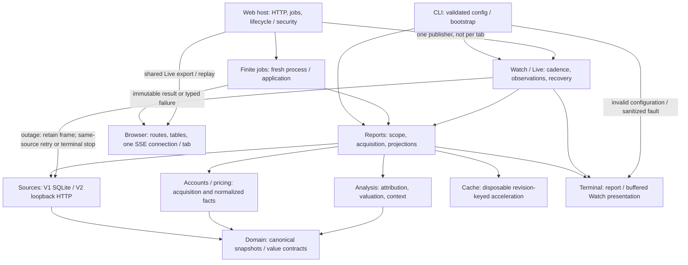
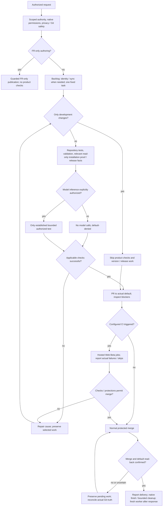

# Cost Guard v80 architecture

Source revision: 302784d150a8bd7b7ac203dfc6cfba88a6ea54cd
Checked revision: 20ab74d5927e6d5dbe1f81701cd8448cbb79f1aa
Last checked: 2026-11-06
Status: current

## Scope and authority

Milestone-60 source map, not an exhaustive correctness audit. Checked revision adds backlog authoring only. `development/journal/architecture.md` records both assessment levels, alternatives and limits. Unchanged module pages retain their own scoped checks.

Toolkit owns workflow/mirrored `development/README.md`; `development/repository.json` holds release facts; `development/applied-contract.json` records identity (revision 6). History is evidence, not instructions. Development-only work activates no product checks/budgets/version work. Shipped source retains functional release rules. Main is supported; packaged Releases remain paused.

## System map

Arrows group calls and consumption, not literal Python imports or one linear pipeline. `cost-guard.py` installs `src/runtime_errors.py` before importing the composition root. CLI parse/config validation precedes source, provider and runtime-cache work. `src/bootstrap.py` composes reports or blocking CLI Watch; it does not route CLI through HTTP. Unexpected faults sanitize evidence and close owned work; Diagnostics observes independently rather than owning product recovery.

### State, lifetime and recovery owners

| Boundary | Authority and transitions |
| --- | --- |
| Web host / finite reports | `src/web/host.py` owns HTTP/jobs and one `src/application/live.py` publisher. `src/web/jobs.py` owns fresh processes, deadlines, parent-loss cleanup/cancellation. `src/application/service.py` validates, allowlists progress and exports immutable values. Foreign/Live rejection must not close it; finite jobs never borrow its mutable service. |
| Shared Live / Watch | `src/watch/acquisition.py` drives the coordinator's initialize/poll/enrich seam; CLI retains its blocking wait adapter. Hints trigger authoritative reads, never usage or completion. Source outage retains the last frame; retry stays in the selected generation, discards partial initialization and ends on terminal/unsupported evidence. Source-change stops rather than reloads. |
| Independent background lanes | `src/watch/web_coordinator.py` owns four card workers, separate single-worker account-history, detail and scalar Sessions-index lanes, plus session-cost reconciliation. Fresh resources isolate blocking work and cancellation; late daily results are checked against the current day. HTTP/pages never tick acquisition. |
| Source consistency | `src/sources/selection.py` chooses one healthy generation; histories never merge. V1 pins a read-only transaction; V2 brackets complete tree hydration with catalog revisions and bounded fresh attempts. Wire/schema adaptation stays below canonical snapshots. Loopback GET, SSE and cancellation have distinct resource lifetimes. |
| Accounts / prices | Attempt/account identity and deadlines reject late quota observations while retaining occupied lanes. Account refresh is independent of source cadence. Normal price-cache fallback differs from explicit strict upstream refresh; optional release metadata has separate freshness. Quotas/capacity, reference CCost and billed cost are not interchangeable. |
| Derived history / cache | Reports own acquisition populations and canonical projections. Cache is reconstructible acceleration, never OpenCode authority or observed history. `src/reports/session_history.py` retains observations; `src/application/session_detail.py` owns revision-pinned rich chunks. `session_catalog.py` owns complete membership, scalar-key coverage and exact global sorts, not page-only guesses. |
| Browser / native launchers | `src/web/security.py` / `http.py` enforce loopback/Host/Origin/method/body/session/CSRF. `lifecycle.py` owns instance arbitration/exact-process restart proof. Browser sequence/gap recovery consumes immutable publications. Native pumps, one-use handoff and host close have separate owners. Windows inspection is not macOS/Finder/Gatekeeper proof. |

## Semantic and dependency contracts

- OpenCode persistence is authoritative and read-only; one analysis core serves finite reports and Watch. Provider/source formats stop at their adapters. Analysis owns causal child/termination attribution, pricing/CCost and historical versus current context; renderers do not revalue or acquire.
- Global comparison samples, Token Mix, period AI Stats, first-input matches and Sessions keys differ in population/validity. AI Stats reuses compact facts/matched-run projection, not a second valuation engine. Match persistence contains digests/scalars; ephemeral previews are never identity.
- Sources/accounts/pricing/cache depend on domain and narrow lower contracts, not reports/presentation. Analysis never imports reports/presentation. Reports depend on source/account/pricing contracts plus analysis/cache, not concrete integrations, Watch or renderers. Application owns detached exports and injected drivers, not bootstrap/Web/Watch imports. Web composition alone wires concrete services/Watch. Domain uses the standard library only. The product validator checks actual layer imports; diagrams are not that proof.
- `src/config.py` owns JSONC merge/normalization/validation: omission inherits; null overrides; reads never create user config. `src/web/settings.py` atomically edits only theme, CCost unit, Mini placement/size and quota orientation. Browser owns native geometry. `src/numbers.py` resets display-unit scope safely; canonical values/quotas are unchanged.

## Module and test navigation

Start with [CODE_MAP.md](modules/CODE_MAP.md) for exact entrypoints, platform wrappers, focused tests and bounded legacy debt. Static test-import paths are navigation, not executed coverage.

| Group | Ownership / public contracts |
| --- | --- |
| Sources | [sources.md](modules/sources.md) |
| Accounts / pricing | [providers.md](modules/providers.md) |
| Domain / analysis / cache | [analysis.md](modules/analysis.md) |
| Reports / application | [reports.md](modules/reports.md) |
| Watch | [watch.md](modules/watch.md) |
| Web / native lifecycle | [web.md](modules/web.md) |
| CLI / presentation / faults / Diagnostics | [presentation-diagnostics.md](modules/presentation-diagnostics.md) |

## Validation, review and delivery flow

Descriptive route: installed contract revision 6, selected worker workflow, `development/repository.json` and CI owners below. No new gate, scheduler, registry, paid inference or self-review. Native safety remains separate from product checks. Failed checks mean unfinished work; uncertain merge needs reconciliation, not replay.

### What runs and why

| Stage | Scope / activation | Disposition | Exact source owner | Failure handling |
| --- | --- | --- | --- | --- |
| FR publication / selection | FR-only authoring or fresh Backlog | Scoped authority; fixed task; sync when outdated | Installed `shared-repo/references/fr-authoring.md`, `shared-repo/references/backlog-worker.md`, `shared-repo/references/contract-sync.md`; `development/applied-contract.json` | Preserve unrelated work; no reselect; no due work/Ready ends no-work |
| Development-only | Changes confined to development | Product tests, validator, budgets and version work disabled | `development/README.md`; installed `shared-repo/references/maintenance.md` | Check changed facts/routes; do not invent product PASS |
| Product verification | Shipped-source changes | Applicable tests/security/release checks | `development/tools/run_tests.py`, `development/tools/validate_package.py`; `development/repository.json`, `src/version.py`, `VERSION_HISTORY.md`, `README.md` | Repair required failures; no weakened assertion/baseline |
| Real installation / inference | Relevant local proof; inference separately authorized | Conditional read-only probes; inference default-denied | `development/tools/collect_diagnostics.py`; exact probes in CODE_MAP; `development/tests/integration/live/` reserved, not a runner | Never stop shared OpenCode; disclose unavailable proof; no invented model dispatch/freeze owner |
| Hosted CI | Cumulative product/test/tool/workflow paths on main PR/push, or manual dispatch; public repo only | Linux plus native Windows/macOS jobs; docs/state-only diff does not trigger | `.github/workflows/web-beta.yml`; `development/tools/ci_web_beta.py` dispatch / `hosted_only`; `development/tests/integration/ci_browser_web.py`, `development/tests/integration/ci_native_web.py` | Bounded phases, explicit missing/failed/skipped evidence; no private paid fallback or workstation spoofing |
| PR / merge | Authorized delivery | Actual checks/protections required; quarantined PR review not automatic | Installed `/repo-backlog`; actual GitHub default / protection state | No force/bypass; uncertain effect needs read-back, not duplicate mutation |
| Delivery / handoff | Confirmed merge and default read-back | Truthful report; native bounded cleanup attempt, deletion success not required | Installed native `repo_backlog` finish | Partial/skipped cleanup does not block; no cleanup retry or second task here |
