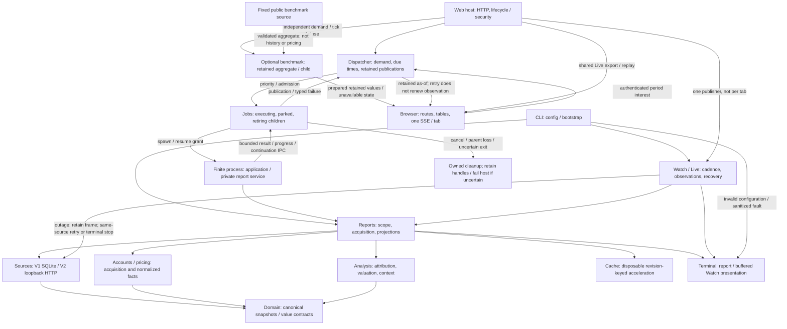
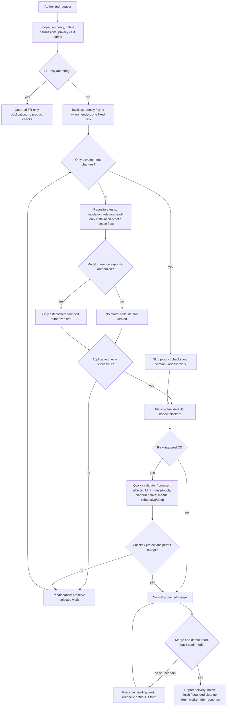

# Cost Guard architecture

Source revision: 3266deeab687ca1c3dac0276b687c543d08cd470
Checked revision: 3266deeab687ca1c3dac0276b687c543d08cd470
Last checked: 2026-11-14
Status: current

## Scope and authority

The [Architecture-150 assessment](governance/verification/architecture-150-20261114.md), [journal](../journal/architecture.md) and modules support this runtime map, not exhaustive correctness. Test Health 150 updates validation only; runtime evidence is not rerun.

Toolkit owns workflow; `development/repository.json` owns release facts, contract revision6. Development-only skips product gates/version. Main is supported; Releases paused.

FR000624 retains readers/brackets below capture, report sampling, Watch guidance and Web demand. Healthy computation has no elapsed cutoff. The [recovery ledger](../journal/web/foreground-recovery.md) separates oracles, exceptions and outstanding gates.

## System map

Arrows group control/consumption, not imports. Both entries install runtime errors first. `src/product_entry.py` routes desktop defaults to managed Web, information locally and legacy arguments unchanged to CLI. Unsupported defaults fail. Bootstrap composes reports/Watch independently of HTTP; configuration precedes integrations. Faults sanitize/close owned work; Diagnostics only observes. Parent loss exits the finite child; uncertain cleanup retains ownership/faults host.

### State, lifetime and recovery owners

| Boundary | Authority and transitions |
| --- | --- |
| Web demand | `src/web/host.py` composes HTTP, dispatcher/jobs and one Live publisher. `dispatch.py` owns retained results, leases, due/backoff and priority; `jobs.py` owns child handles, bounded IPC/cancellation, not report mathematics. See [data-dispatch.md](modules/data-dispatch.md). |
| Finite recovery | `report_control.py` parks private stacks pending host/read grants. History/stats jobs have distinct continuations, not universal elapsed deadlines. Reports qualify compact coverage; application service exports immutable values and never closes rejected foreign/Live services. Uncertain exit retains exact handles/fails host. |
| Watch | `src/watch/acquisition.py` owns initialize/poll/enrich; CLI adapts blocking waits. Hints cause reads, never usage/completion. Outages retain frames; selected-generation retry discards partial initialization. Terminal evidence ends recovery; source change stops, not reloads. |
| Background lanes | `src/watch/web_coordinator.py` separates four card workers, account-history, detail-supervisor and scalar index lanes. Web injects a killable detail child; measured no-progress retirement and attempt/epoch guards reject late publication. Daily results check day identity; pages never tick acquisition. |
| Sources | `src/sources/selection.py` selects one generation, never merged histories. V1 pins read-only transactions; V2 brackets hydration with catalog revisions/bounded fresh attempts. GET/SSE/cancellation lifetimes differ; wire formats stop below canonical snapshots. |
| Providers | Attempt/account identity and deadlines reject late quota values while retaining occupied lanes. Refresh is source-independent. Price fallback differs from strict refresh; release metadata has separate freshness. Quotas, reference CCost and billed cost differ. |
| History / cache | Reports own populations/projections; cache is disposable acceleration. Session history retains observations; application detail owns pinned chunks. Catalog owns period membership/scalar coverage/eight scoped sorts: retained display fields do not qualify pending keys. Token Mix reuses revision-qualified facts after canonical deduplication/request-time filtering. |
| Browser / native | `src/web/security.py`/`http.py` enforce loopback/Host/Origin/method/body/session/CSRF; lifecycle owns exact-process restart proof. Browser gap recovery consumes immutable values. Native pumps, handoff and host close differ. Windows proof is not macOS/Finder/Gatekeeper proof. |
| Navigation / benchmark | Sessions leases serve detached 25-row pages from a complete-population scalar lane; Today is AI-Stats-independent. Cancel retires navigation, not shared work. Benchmark reuses `ReportJobs` with independent aggregate cache/freshness/timeout, never prices/history. See [module flow](modules/web.md#architecture-150-source-map). |

## Semantic and dependency contracts

- OpenCode is read-only authority. One analysis core serves finite reports/Watch, owning causal attribution, valuation and historical/current context; renderers neither acquire nor revalue.
- Comparison/Token Mix/AI Stats/matches/Sessions have distinct populations. AI Stats reuses compact facts; persisted digests/scalars, never previews, establish identity.
- `src/reports/shared_evidence.py` publishes compatible facts under source/revision/algorithm/config/price keys. Stable complete snapshots qualify publication; consumers still own populations/completeness/totals. Publication, refresh job and source observation differ.
- Lower adapters/analysis never import reports/presentation. Reports use abstract integrations, analysis/cache, not concrete adapters/Watch/renderers. Application owns detached exports/drivers; only Web composition wires concrete services. Domain is standard-library-only. Validator imports, not diagrams, prove layering.
- Configuration owns JSONC merge/validation: omission inherits, null overrides, reads never create user config. Web settings atomically edit only theme/unit/Mini geometry/quota orientation. Browser owns native geometry; display-unit scope never changes canonical values.

## Module and test navigation

Start with [CODE_MAP.md](modules/CODE_MAP.md) for entrypoints/tests/debt. Static imports are navigation, not executed coverage.

| Group | Ownership / public contracts |
| --- | --- |
| Sources | [source contracts](modules/sources.md) |
| Accounts/pricing | [providers](modules/providers.md) |
| Domain/analysis/cache | [analysis](modules/analysis.md) |
| Reports/application | [reports](modules/reports.md) |
| Web demand/jobs | [dispatch](modules/data-dispatch.md) |
| Watch | [Watch](modules/watch.md) |
| Web/native | [Web](modules/web.md) |
| CLI/faults/Diagnostics | [presentation](modules/presentation-diagnostics.md) |

## Validation, review and delivery flow

Test Health150: affected tooltip owners/probes run mouse/touch with two61s PiP/Watch holds; manual Full retains twelve, mixed/control and deep pager/navigation/zoom/stall checks, even with unchanged owners. Ten holds/mixed/control are retired from ordinary CI, not marked PASS. [Evidence](governance/verification/test-health-150-20261114.md) separates checks/estimates. No new gate/scheduler/inference; repair failures, reconcile uncertain merges without replay.

### What runs and why

| Stage | Scope / activation | Disposition | Exact source owner | Failure handling |
| --- | --- | --- | --- | --- |
| FR / selection | Authoring/fresh Backlog | Scoped fixed task; sync if outdated | Installed `shared-repo`; `development/applied-contract.json` | Preserve unrelated work; no reselect |
| Development-only | Development/docs | No product gates/version | `development/README.md`; installed method | Verify tooling/facts; no product PASS |
| Product verification | Shipped source | Applicable checks/release facts | `development/tools/run_tests.py`, `development/tools/validate_package.py`; `development/repository.json` | Repair failures; focused checks available |
| Installation / inference | Relevant local evidence | Read-only probes; inference default-denied | CODE_MAP; `development/tools/collect_diagnostics.py` | Never stop shared OpenCode; disclose gaps |
| Common CI | Cumulative product/test/tool PR/push; public only | Quick/validator/browser; affected Mini mouse/touch/two holds. Manual Full: twelve/mixed/control/deep | `.github/workflows/web-beta.yml`; `development/tools/ci_web_beta.py`; `development/tests/integration/ci_browser_web.py`, `ci_mini_tooltips.py`, `probe_hover_stationary.cjs` | Exact reports; omitted NOT RUN; incomplete not PASS; hosted-only |
| Native CI | Platform-risk source/tests/tools; manual | Windows/macOS ARM/Intel profile + smoke | `.github/workflows/native-web.yml`; `development/tools/ci_web_beta.py`; `development/tests/integration/ci_native_web.py` | No private paid fallback; retain deadlines/phase truth; isolated assets/calculations skip |
| Delivery | Authorized, confirmed merge/default | Checks/protections; native finish/cleanup | Installed `/repo-backlog`; GitHub | No force/replay/cleanup gate/second task |
