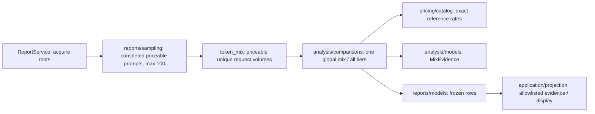

# Analysis source contracts

[Architecture overview](../OVERVIEW.md) · [Owner/test routes](CODE_MAP.md). Source remains authoritative.

Source revision: c87bd954decd5bc36ea06409abc1a78d3c7951c2
Checked revision: c87bd954decd5bc36ea06409abc1a78d3c7951c2
Last checked: 2026-10-30
Status: current

FR 000530 adds Web-only active-hour analysis without changing module boundaries; FR 000534's global comparison policy remains unchanged.

## Responsibility and ownership

Canonical domain, source-neutral analysis and disposable cache have separate owners.

## Public contract

### Canonical domain

The domain separates:

1. Usage — normalized sessions/messages/parts/events/model invocations and I/C/W/O/reasoning token observations.
2. CCost/Billed — independent reference token valuation and actual provider-reported/included billing evidence. Legacy estimated billing fallback is never surfaced as actual spend.
3. Quota/limits — native account units, used/limit/remaining, percentages/windows, reset time and availability state. Provider-native budgets remain supported; the deprecated local monthly CCost budget has no runtime semantics.

Equal numbers are not interchangeable. Analysis consumes capabilities/domain semantics, not version names.

`TokenUsage.known_fields` preserves telemetry availability through normalization/cache; absent/null/malformed fields stay unknown. `analysis/token_mix.py` sums volume, folds reasoning into O, apportions 100% and hides shares for unknown denominators. Category CCost reconciles with `comparison_cost`; `priceable_request` is the one per-request sample rule (real usage, complete telemetry, resolvable reference tier rates) behind priced-only mixes and Relative CCost usage; model rows use reference identity, unique prompts/all calls. `analysis/quota_pace.py` uses fixed-period remaining/reset and workdays, never session state.

`src/domain/accounts.py` owns source-aware `AccountRef`, flexible `QuotaComponent`, `BillingComponent` and `AccountSnapshot`. A request may carry an optional proven account reference. Current-login identity never fills historical request gaps. `src/domain/` must not import concrete source/account/pricing/cache/watch/presentation implementations.

`domain/session_tree.py` shares catalog ancestry/tree activity, never acquisition/attribution. Missing ancestors/cycles terminate without invented records; missing ancestry cannot resolve detail targets. Reports retain archived history; Watch excludes archived roots.

`domain/ccost.py` owns reference conversion (100 CCost/USD), `CCostPricing` and valuation contracts. Catalog `models` remain native monetary metadata; immutable `ccost_models` are converted once before reference usage/category/context/comparison analysis, never billing fallback. Unknown currencies are unpriceable, not guessed FX. CCost is Copilot AI-credit-equivalent reference value, not deduction/billing; projections use explicit CCost fields.

`src/numbers.py` owns display rounding: credits use upward CCost, reference USD uses 100 CCost/USD and two decimals; native consumption/Remaining keep upward/downward rounding, rates/limits stay exact. `ccost_display` scopes synchronous render/export with ContextVar reset even on exceptions. It never converts canonical analysis values or native billing/quota amounts; analysis never calls it. `version.mode_heading` owns startup grammar, CLI modes, progress transient rows. Reports align all quota labels; Watch only primary labels.

### Analysis

`analysis/period_ccost.py` resolves native duration/reset intervals, opt-in supported UTC calendar months, or explicit empty half-open scopes for provider-confirmed not-started windows. Empty scopes never select historical requests; contradictory evidence has no interval. Reports gate native costs on account availability. `AccountPeriodHistory` retains an immutable prefix index and acquisition boundary, not a native quota snapshot, so Web publication reprojects current accounts/windows without source I/O or repricing. Acquisition coverage is checked per scope: pending monthly history cannot erase an acquired Today/secondary window. Watch's `QuotaPeriodProjection` associates each quota (including equal-label model scopes) with its own cost and canonical pace. Today/local month/native monthly Watch CCost and UTC monthly residual accounting stay independent. Regression owners: `test_account_period_ccost.py`, `test_quota_period_lifecycle.py`, `test_watch_daily.py`, `test_copilot_unaccounted_usage.py`.

`src/analysis/` owns attribution, prompt/child/synthetic/compaction semantics, clone billing de-duplication, context and comparisons over canonical domain/provider-neutral abstractions only.

Usage/billing consumes all canonical providers: V2 `openai` requests must not disappear because pricing/quota integrations are Copilot-backed. Positive provider-reported cost stays authoritative; fallback and quota are separate capabilities. Provider filters are explicit lower-level/testing scopes only, never default report truth.

The causal core uses `TraceEntry`, `PromptRecord`, `CompactionRecord` and `RootAnalysisBundle`. Billing retains reported/included/fallback provenance. `analysis/valuation.py` independently derives `ComparisonCost` via reference estimation and actual `billed_spend`, never substituting fallback prices. Subscription CCost exposes priced/observed coverage, never billed dollars for unsupported models. `ReportService` may take a separate comparison catalog provider. Exact catalog identities prevent fuzzy CCost matches; clone de-duplication retains source-instance provenance. Root-first provenance reconciles main/subagent CCost before rounding.

`analysis/child_links.py` is the shared owner of `task`/`subagent` child evidence and invocation windows. It prefers structured state/top-level metadata, permits only exact native output envelopes as fallback, validates acquired session parentage and coalesces physical tool copies before traversal. Foreground nested scopes intersect their parent; an evidenced background descendant can outlive the parent only when its launch belongs inside that parent's window. Later invocations bound earlier background windows. `causal.py` unions actual normalized invocation identities inside those windows; `watch/tools.py` follows the same scoped messages/parts. Neither consumer retrieves sessions or prices children separately. Derived algorithm 16 invalidates prior attribution; full root-tree CCost remains independently authoritative. Missing ancestry/timing never authorizes residual allocation. Regressions: `test_child_links.py`, `test_subagent_attribution.py`.

Context/comparison consumes canonical messages/parts/invocations. `analysis/context_history.py` separates request-local input from persisted history; unsupported decreases stay unknown. `estimate_event_context` preserves historical completion estimates independently of current anchor retirement. Model-selection boundaries allow historical comparison only with compatible telemetry and complete retained same-model history; resets remain separate epochs. Accounting stays independent. Completed compaction owns its summary/tail and negative delta. Next-Ictx never predicts cache hits; current warnings require eligible anchors. Comparison prices every target model/tier under one shared pooled I/C/W/O mix from the latest up to 100 completed priceable prompts globally, with a common cheapest positive base reference. `src/analysis/comparisons.py` uses `normalized_average_token_mix`; model/publisher profiles do not affect ranking or tier-warning ratios. The independent dashboard usage mix may include running/interrupted usage. Full-Decimal sorting orders base/next-tier prices descending, earlier boundaries, then name, recursively. Without samples, hidden 2/96/1/1 sorts while Relative CCost stays blank. Diagnostics never feed billing.

FR000653 (v81.2) separates historical pair evidence from active-history eligibility:
retained complete root input and same-epoch next context can support a prompt-local
delta after undo/compaction removes current membership. This never revives session
continuation or warnings. Different root/provider/model, missing first input and
in-prompt rewrites cannot create that fallback; richer comparable prior anchors still
win. Running compaction invalidation cannot fall through to pre-rewrite provisional
text. Short canonical unavailable/provisional detail travels through report/Live;
Mini retains session-scoped historical Next and prompt-scoped delta. Coverage:
context history/comparison, move, V1/V2 normalization, Mini/Live and browser probes.

Stable complete analysis requires exact source revision, algorithm/config compatibility and a semantic pricing signature (identities/aliases, currency, rates/tiers), not retrieval timestamps/document labels. Malformed/incompatible, running or incomplete results never persist. Revisions remain conservative gates, not semantic truth.

Dates use `zoneinfo`; clean Windows Python may lack IANA data, so dependency-free current rules cover shipped `Europe/Stockholm` and UTC. Other IANA zones fail actionably without host data; never substitute local time.

`analysis/effort.py` distinguishes explicit, request-proven/unresolved Default and unattributable effort. Only matching root requests resolve Default, never model/pricing maps or mutable session selection; V2 never stamps session effort onto history. Renderers share one label (no `Default -> X`); compaction uses its own explicit variant.

FR000694 (v81.38) adds separate **tooltip-only** `domain/effort.py` evidence.
`TraceEntry.selected_effort` joins only the exact same-session initiating event
and recorded provider/model; explicit variants and unattributable summaries retain
their existing semantics. `analysis/effort_defaults.py` resolves request evidence,
then current location-qualified source estimates, then exact reviewed vendor routes.
The 31-model mapping includes conditional/unknown entries, never price-tier inference.
`sources/opencode_v2_effort.py` accepts bounded allowlisted options only for supported
packages; `DesktopModelCatalog` shares its two location reads/30s and fingerprints
only relevant options. `ModelRef.effort_default` is excluded from model equality,
pricing and deduplication; dependency validation separately retains distinct scopes.
Algorithm 20 rebuilds disposable tooltip evidence, including compact response/match
projections. No native history mutation or tooltip-open acquisition occurs.
See [evidence and limits](../../journal/default-effort-help.md).

The latest assistant's `termination` ends running/duration and distinguishes success/failure/cancellation, even without usage. Actual root/child or newer tool activity stays live; stale tool flags do not. Reports/Watch/resync share this truth. Running background work keeps the newest prompt active without usage; resumes stay on it. Incomplete inference stays uncached; older algorithm keys are invalidated.

FR000630 adds canonical `execution_unverified`: a complete snapshot with a valid
negative native observation, latest unfinished assistant and no positive scoped
tool/child/background activity does not assert execution or completion. The native
drain map is process-local, not a cross-server end. Usage remains; terminal time is
absent and projected execution duration is unknown. Positive activity, later attempts
and supported terminal evidence recover normally. Reports exclude uncertainty from
completed comparison samples, not observed Token Mix. Shared observed-history
retention prevents missing/unchanged unavailable evidence from reviving a live clock;
Watch and all presenters consume the same flag. Algorithm 19 invalidates prior
classification; unfinished results stay uncached. See the [lifecycle evidence and
scoped historical-source exception](../../journal/web/watch-terminal-lifecycle.md).

`analysis/duration.py` qualifies retrospective execution boundaries from normalized assistant/tool/background evidence, never session metadata or report time for terminated work. `PromptRecord.execution_duration_ms` and compaction timing survive derived caching; the legacy prompt `duration_ms` remains unchanged for Watch. Reports project qualified timing into `PromptProjection.duration_ms`; listings union the cached bundle directly, without detail hydration. A sorted interval union excludes idle gaps/overlap and propagates unknown timing to `N/A`; date totals union only selected events. Presentation shares Watch's compact formatter, not timing calculations.

`src/analysis/active_hour.py` owns reference cost per active hour. It reuses canonical
prompt/compaction execution boundaries, clips before overlap union across roots,
reconciles request/step identities and reuses clone deduplication/event-time CCost.
Configured local day/month boundaries differ from exactly trailing 30 x 24 hours.
Unknown telemetry/pricing/time suppresses the rate; running evidence is provisional.
`ReportService.build_cost_per_hour` is an explicit finite Web capture, never Normal,
Watch or CLI polling. The application exports exact Decimal values and prepared
credits/USD tokens; the browser never calculates rates. Complete-session rates
use whole-report totals even when detail pages contain only 50 rows. Source loss
retains the observed clock, not proof of completion. No durable ledger is added.

### Cache

Disposable `cache/` uses generation-named SQLite, WAL, short transactions, a default 5s busy timeout and explicit close after commit/rollback. Breaking schemas use a new generation; additive lifecycle tables do not rewrite existing payloads. JSON carries source/algorithm revisions and bounded coordination, never sole history/credential ownership. Manual cache deletion requires Cost Guard stopped. Atomic `model_first_sightings` rows keep shared provider-qualified UTC Report/Watch presentation timestamps.

### Session-cache lifecycle (FR 000626)

FR000629 scoped identity delta (2026-11-09): optional per-entry identity semantics
reject legacy alias-derived full analyses, summaries, compact Token Mix/AI Stats
facts and matched runs on ordinary access. Original provider/model IDs detect the
affected entries; raw snapshots are unchanged and unaffected legacy entries remain
hits. Legacy nonempty scalar labels without contributor identity are reacquired
rather than trusted. Root-tree CCost salts only moving-alias request fingerprints,
preserving pinned contributions and aggregate checkpoints. No global algorithm bump,
purge, startup sweep or retention change. Tests: `test_claude_alias_identity.py`,
`test_claude_alias_cache.py`; [dependency/evidence detail](../../journal/claude-alias-identity.md).

`cache/session_scope.py` reduces complete, quiescent source snapshots to a source-qualified root digest and nullable actual activity clock across messages, child invocations, parts and ended background work. Session creation/update/archive is not activity proof. Unknown/missing execution times remain ineligible. `CacheEntry.session_scope` opts individual derived/compact/statistics/coverage/match/summary/CCost entries into the additive indexed `cache_entry_lifecycle` table, atomically with payload publication. Unannotated old rows stay protected without startup source hydration; incomplete replacements remove old activity proof. Pricing, model sightings/discovery and separate JSON operational state are not eligible.

`cache/lifecycle.py` owns bounded use updates and eviction, never source acquisition. Actual UI delivery (including job polling, retained report interest, visible Sessions/detail and Full/Mini Watch) queues root touches; the shipped UI's selected-visible header distinguishes demand from headerless probes. Explicit CLI presentation drains its own touches. Reads/passive writes do not renew use. Hourly coalescing has an extra retention-hour grace. Pending/failed touches protect their roots; flushes update at most 64 entries.

`web/cache_housekeeping.py` runs from the existing host loop, not another thread/timer/service. It waits 60 continuous host minutes and attempts at most one eight-entry transaction daily, using a fresh ordinary Watch catalog's same-source inactive revisions. Foreground HTTP (not permanent SSE), finite jobs, Live/provider/acquisition pressure, detail/catalog leases, visible requests/cards, revision changes, shutdown and pending touches protect/defer work. Zero busy wait and a cooperative 20ms SQLite deadline bound attempts; errors roll back/fail soft. This is not a hard OS/filesystem latency guarantee. No VACUUM/checkpoint or startup sweep is added; freelist reuse need not shrink file bytes. See [verification and limitations](../../journal/cache-lifecycle.md).

## Allowed dependencies

Domain uses the standard library; analysis consumes canonical domain and provider-neutral catalog contracts, not source transports, report orchestration or presentation. Cache is reconstructible storage, never source authority.

## Entrypoints

`src/analysis/core.py` composes attribution/compaction; `src/analysis/comparisons.py` prices the shared global sample; `src/analysis/models.py` owns the retained `MixEvidence` value; `src/analysis/valuation.py` owns reference valuation; `src/cache/database.py` owns transactions.

### Comparison ownership checked 2026-11-04

Architecture maintenance 30 removes the unreachable model/publisher profile engine and its deep comparison cache orchestration, not historical Token Mix. The existing evidence fields/defaults remain wire-compatible; ordinary comparison rows still explicitly report zero model/publisher/prior counts and the actual global count. No compatibility import shim, cache migration or second sampling owner remains.

`ReportService._threshold_multiplier` reuses the same sampling/volume rules and its existing 15-minute observation cache. Historical model/publisher aggregation remains in `reports/token_mix_history.py`. Focused ownership/negative cases: `test_workload_mix.py` and `test_report_sampling.py`; actual execution and sweep coverage are in [the architecture assessment](../../journal/architecture.md).

## Tests

`development/tests/test_active_hour.py` (formula, period/DST, concurrency, missing data and full-session rates), `development/tests/test_analysis_core.py`, `development/tests/test_context_history_projection.py`, `development/tests/test_workload_mix.py`, `development/tests/test_cache.py`, `development/tests/test_ccost_display_unit.py`. Inspected source/assertions are not a fresh test PASS.
